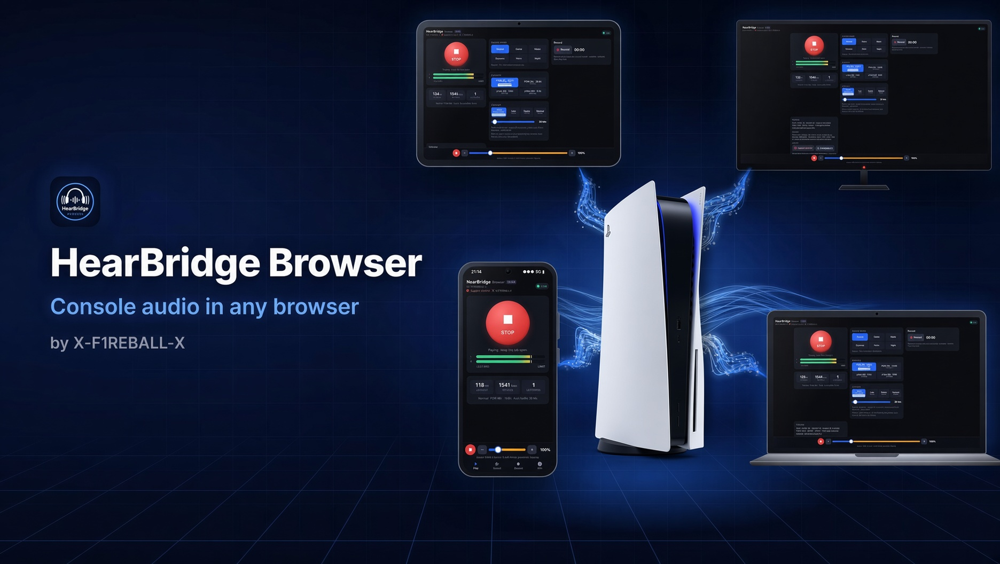
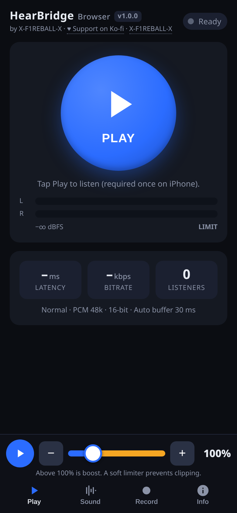
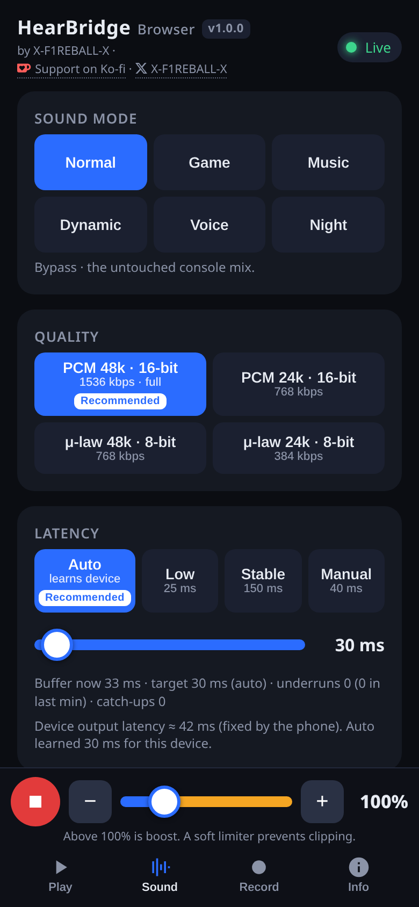
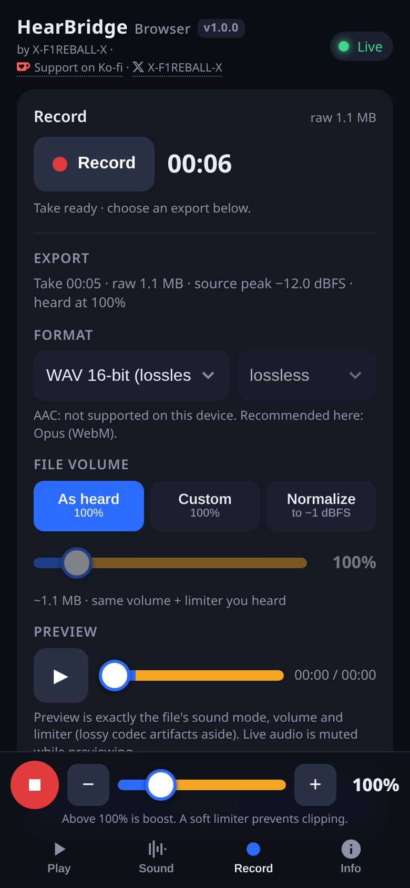
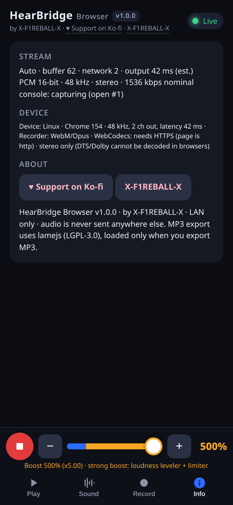
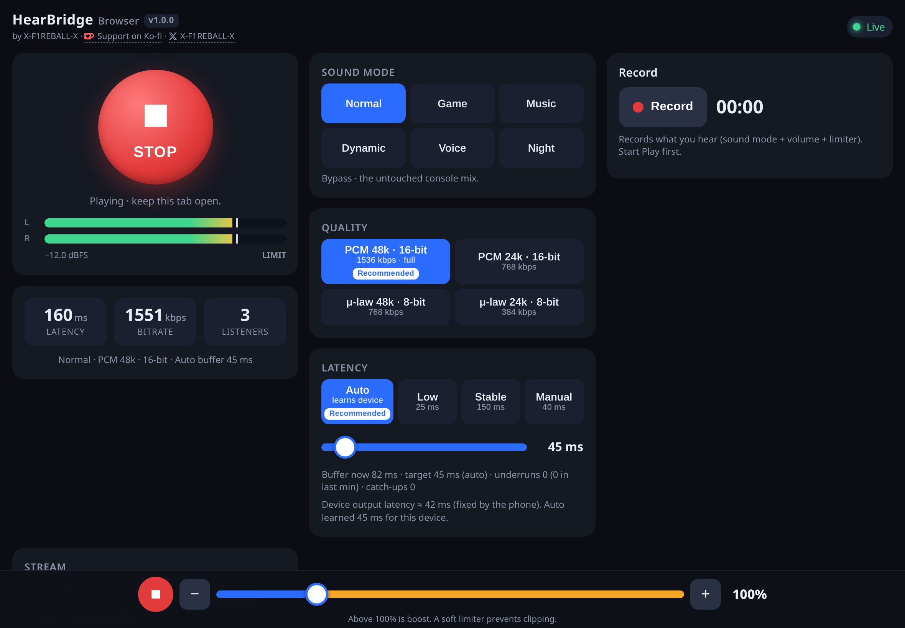

Listen to your PS5's audio on your phone, tablet or PC. No Bluetooth or extra hardware, just a browser (or the Android/Windows app) on the same Wi-Fi.

HearBridge Browser is a small payload for a jailbroken PS5. It captures the console's audio output and serves it on your local network, together with a player page. Open the page, tap Play, and you hear the game.

Full guide with setup, tips and FAQ: https://x-f1reball-x.github.io/HearBridge-Browser/

## Features

- **Works in any modern browser**: Chrome, Firefox, Edge, Safari, including iPhone and iPad.
- **Android app**: finds your console on the network by itself, so you don't have to type the IP.
- **Windows app**: a small portable `.exe` that opens the player in its own window. Nothing to install.
- **Volume boost up to 500%**, with a soft limiter so it doesn't clip or distort.
- **Sound modes**: Normal, Game, Music, Dynamic, Voice and Night.
- **Automatic latency**: the Auto buffer learns the lowest delay your device can handle without dropouts. You can also pick Low, Stable or set it by hand.
- **Record and export**: record what you hear and save it as WAV, FLAC, MP3 or Opus.
- **Device detection**: the page checks what your browser supports, marks the recommended settings and greys out the ones that won't work.
- Several people can listen at the same time, each with their own quality setting.

## Requirements

- A jailbroken PS5 with an ELF loader listening on port **9021**.
- A phone, tablet or computer on the same local network as the console.

## Install

1. Download `hearbridge-browser-1.0.0.elf` from the [Releases](../../releases) page.
2. Send it to the console's ELF loader on port 9021, for example:
   ```
   nc -q0 <console-ip> 9021 < hearbridge-browser-1.0.0.elf
   ```
   or use any payload sender you already have.
3. Wait for the notification on the PS5, then on your device open:
   ```
   http://<console-ip>:8096
   ```
   Or install `HearBridge-Browser-1.0.0.apk` on Android and pick your console from the list.

### Windows app

Download `HearBridge-Browser-1.0.0-windows-x64.exe` from the [Releases](../../releases) page and run it. No install needed.

- Needs Windows 10 or 11 (x64) with the WebView2 runtime. It's built into Windows 11 and current Windows 10, so you most likely have it already.
- The exe isn't signed, so SmartScreen may warn you the first time. Click **More info**, then **Run anyway**.
- If it can't reach the console, type your console's IP in the box and press Retry. It remembers the last IP that worked.

The payload keeps running until you stop it or turn off the console. Sending it again replaces the running copy.

## Usage

On a phone the page has four tabs. The mini player with the volume slider is always at the bottom. On a tablet or desktop everything is on one screen.

**Play**: the big Play button, L/R level meters, and live stats (latency, bitrate, number of listeners). The volume slider goes from 0 to 500%; anything above 100% is boost.

**Sound**: pick a sound mode, the stream quality (PCM 48k or 24k, or the lighter μ-law versions for weak Wi-Fi) and the buffer (Auto, Low, Stable or Manual). Your choices are saved per device.

**Record**: start and stop a recording, listen to a preview, then export as WAV, FLAC, MP3 or Opus. You can keep the volume as you heard it, set a custom level, or normalize the file.

**Info**: connection details, what your device supports, and links.

If you prefer a media player, `http://<console-ip>:8096/live.wav` works in VLC or ffplay.

## FAQ

**Do I need Bluetooth or any extra hardware?**
No. Everything goes over your normal Wi-Fi or Ethernet network.

**Does my audio go to the internet?**
No. It only works on your local network. The console streams directly to your device and nothing leaves your network. The page doesn't load anything from outside either.

**Why no Dolby or DTS?**
Browsers can't decode Dolby or DTS streams, so the audio is sent as plain stereo. Set the PS5 audio output to stereo / linear PCM if you hear nothing.

**I hear nothing on my iPhone.**
Check the silent switch on the side of the phone and the volume buttons. HearBridge asks iOS to play even in silent mode, but some iOS versions still mute the browser when the switch is on. If iOS interrupts the audio (a call, Siri, etc.), tap "Tap to resume audio".

**How do I stop it?**
Send a POST to `http://<console-ip>:8096/api/stop`, or reboot the console.

## Screenshots

<table>
  <tr>
    <th>Play</th>
    <th>Sound</th>
    <th>Record</th>
    <th>Info</th>
  </tr>
  <tr>
    <td width="25%"></td>
    <td width="25%"></td>
    <td width="25%"></td>
    <td width="25%"></td>
  </tr>
  <tr>
    <th colspan="4">Tablet</th>
  </tr>
  <tr>
    <td colspan="4"></td>
  </tr>
</table>

## Building from source

### PS5 payload

You need the [ps5-payload-sdk](https://github.com/ps5-payload-dev/sdk) and Python 3.

```
export PS5_PAYLOAD_SDK=/path/to/ps5-payload-sdk
./build.sh          # PS5 payload -> dist/hearbridge-browser-1.0.0.elf
./build.sh host     # local test server for your PC -> build/hearbridge-browser-host
```

The PS5 build needs `PS5_PAYLOAD_SDK` set to your sdk folder, with the sdk's LLVM toolchain on your `PATH`. If it isn't set, `build.sh` stops with an error. The host build doesn't need the sdk. The player page (`web/index.html`) and the MP3 encoder are embedded into the ELF by `tools/embed.py`.

The host build plays a test tone, so you can work on the page without a console. Use `HB_TEST=program ./build/hearbridge-browser-host` for something closer to real game audio.

### Android app

Needs JDK 17+ and the Android SDK.

```
cd android
./gradlew assembleRelease
```

Release signing reads `android/keystore/keystore.properties`. Without it the APK is built unsigned. See [android/README.md](android/README.md).

### Windows app

Needs Go 1.24+ and [go-winres](https://github.com/tc-hib/go-winres) (the script installs it if it's missing). Builds from Linux or Windows (Git Bash).

```
cd windows
./build.sh          # -> windows/dist/HearBridge-Browser-1.0.0-windows-x64.exe
```

The icon and version info are generated into a `.syso` file during the build. See [windows/README.md](windows/README.md).

## Credits

- The audio capture code comes from my earlier project [HearBridge PS5](https://github.com/X-F1REBALL-X/HearBridge-PS5), and the limiter in the page is a port of its `gain.c`.
- MP3 export uses [lamejs](https://github.com/zhuker/lamejs) (LGPL-3.0, unmodified, in `vendor/lamejs`).

## Support

If you like the project, you can buy me a coffee:

- Ko-fi: https://ko-fi.com/XF1REBALLX
- X: [X-F1REBALL-X](https://x.com/XxF1REBALLxX)

## License

GPL-3.0-or-later. See [LICENSE](LICENSE) and [NOTICE](NOTICE).
